# Manual de Usuario de LibreTracks

LibreTracks está pensado para directores musicales, playback engineers y músicos que necesitan un entorno multitrack fiable para el directo. La app mantiene la edición no destructiva y separa el motor de audio de la UI en React, para que organizar, guardar y lanzar una canción no dependa de modificar el audio original.

> ⚠️ Consejo de directo: prepara el show con antelación, guarda la sesión y ensaya los saltos con el mismo dispositivo de salida que usarás en escenario.

## 1. Introducción

LibreTracks te permite importar audio, organizarlos en un timeline y disparar saltos musicales entre secciones durante la reproducción.

Por qué es seguro para directo:

- La edición es no destructiva. Los audios originales no se reescriben al mover o cortar clips.
- El runtime desktop mantiene el motor de audio desacoplado de la capa de UI.
- Comportamientos como `Inmediato`, `En la siguiente marca` y `Tras X compases` se resuelven en la lógica Rust del transporte, no con temporización improvisada en la interfaz.

## 2. Configuración de Audio

### Abre `Configuracion`

1. Abre `Configuracion` desde el panel lateral.
2. En el panel de audio, elige el `Dispositivo de audio` correcto.
3. Verifica la salida antes del ensayo y antes del show.

Si dejas `Dispositivo de audio` en `Predeterminado del sistema`, LibreTracks seguirá la salida por defecto del sistema operativo. En directo, normalmente es más seguro usar una interfaz dedicada.

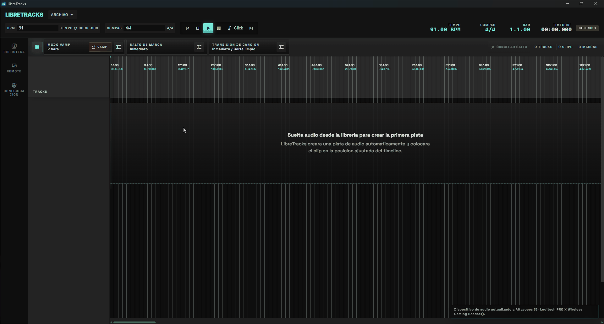

### Configura salidas de hardware

Activa los canales de hardware que quieras usar en `Configuracion > Audio`. Cada pista puede rutear a `Master` o directamente a salidas `Ext. Out` mono y pares estereo desde la cabecera de la pista.

Uso tipico en escenario:

- Envia stems y playback musical a `Master`.
- Rutea click, count-ins, cues habladas o guias directamente a una salida externa de cue.
- Mantén las salidas de cue independientes del fader de Master.

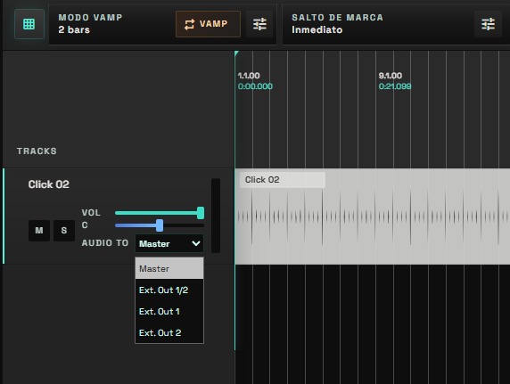

### Usa el `Metronomo` integrado

Activa `Metronomo` desde `La barra superior` cuando necesites una claqueta fiable sin importar un archivo de audio aparte. Elige la salida del metronomo en ajustes y ajusta `Volumen del metronomo` antes del ensayo para colocarlo bien en la mezcla de cue.

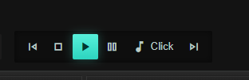

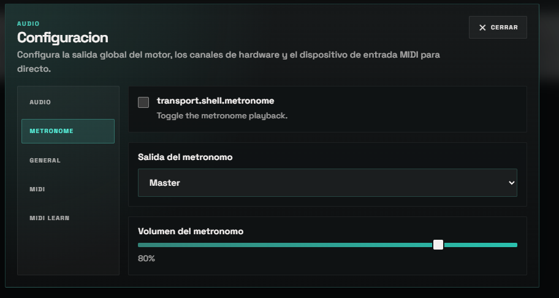

### Conecta hardware MIDI

En `Configuracion`, elige un `Dispositivo de entrada MIDI`, por ejemplo una pedalera, un controlador de pads o un teclado. Usa `Refrescar dispositivos MIDI` si conectaste el controlador despues de abrir LibreTracks.

Abre `Aprendizaje MIDI` para asignar notas o mensajes CC del hardware a controles en vivo. Son mapeos utiles `Reproducir`, `Detener`, `Vamp`, modos de salto de marca, disparadores de salto de cancion, modo de transicion de cancion y controles de numero de compases.

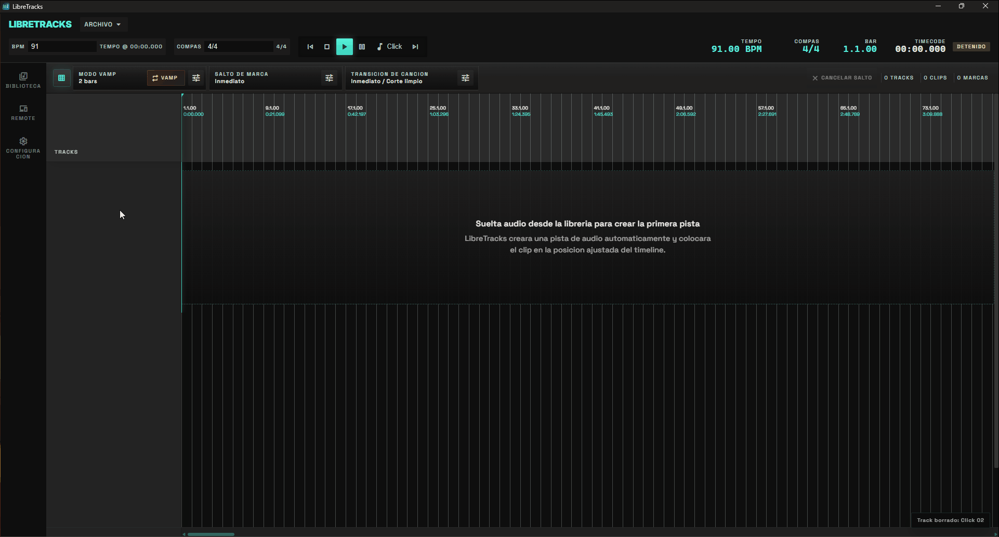

Si se desenchufa el dispositivo MIDI seleccionado, la barra superior muestra `Controlador MIDI desconectado`. No hace falta hacer nada: LibreTracks lo reconecta solo en cuanto lo vuelves a enchufar, y la pestaña MIDI actualiza sus listas por sí misma.

### MIDI en iPhone, iPad y Android

Las pestañas `MIDI` y `Aprendizaje MIDI` funcionan igual en un teléfono o una tableta: elige una entrada para tu pedalera o controlador, una salida para tus pistas MIDI y enseña los controles con `Aprender`.

Qué puedes conectar:

- **USB**: cualquier controlador, pedalera o interfaz MIDI class-compliant. En iPhone y iPad, con el adaptador de cámara (Lightning) o directamente al USB-C. En Android, con un cable o adaptador OTG. No hace falta ningún permiso.
- **Bluetooth LE**: pedaleras y controladores inalámbricos (WIDI, CME, M-VAVE, AirTurn…). En la pestaña `MIDI`, toca `Buscar dispositivos Bluetooth`. En iPhone y iPad se abre el panel de MIDI Bluetooth del sistema; en Android, LibreTracks busca durante unos 10 segundos y muestra lo que encuentra. Después el dispositivo aparece en las listas de entrada y salida como uno USB. Android pide el permiso de Bluetooth la primera vez; si lo deniegas, el MIDI por USB sigue funcionando.
- **Otras apps del mismo dispositivo**: activa `Publicar puerto MIDI virtual LibreTracks`. Los sintes, las apps de letras o de luces del mismo teléfono o tableta ven un dispositivo MIDI `LibreTracks`: reciben lo que tus pistas MIDI mandan a `LibreTracks Out`, y lo que ellas mandan a `LibreTracks In` puede disparar tus mapeos de Aprendizaje MIDI.
- **Wi-Fi, solo iPhone y iPad**: activa `Sesión MIDI de red` y, en el Mac, abre `Configuración de Audio MIDI` → `Ventana` → `Mostrar estudio MIDI` → `Red`, donde aparece tu dispositivo. iOS pide acceso a la red local la primera vez.

En segundo plano:

- **Android**: un pedal puede arrancar el show aunque la pantalla esté apagada o haya otra app abierta. Para ahorrar batería, desactiva `Mantener MIDI activo en segundo plano`: la entrada MIDI se cierra mientras LibreTracks está en segundo plano y parado, y se vuelve a abrir al volver.
- **iPhone y iPad**: iOS suspende las apps que están en pausa en segundo plano, así que un pedal puede dar play mientras LibreTracks está en pantalla o ya reproduciendo, pero no desde la pantalla de bloqueo con la app parada.
- Cuando LibreTracks pasa a segundo plano parado, manda `All Notes Off` a sus salidas MIDI para que nada se quede sonando en el dispositivo que las recibe.

## 3. Organización del Proyecto

### Navegación y portadas

El botón de menú junto a la marca de la barra superior oculta o restaura la navegación de Biblioteca, Configuración y Red, tanto en ordenador como en móvil. La preferencia se conserva en el dispositivo.

Al crear una canción desde una carpeta de la biblioteca, LibreTracks busca imágenes en esa carpeta y sus subcarpetas, dando prioridad a nombres como `cover`, `album`, `portada`, `front` y `folder`. También puedes usar `Elegir portada…` y `Quitar portada` en las opciones de la canción o en `Setlist → Editar → Canción`. Se admiten JPG, PNG y WebP de hasta 8 MB; se guarda una miniatura para no ocupar altura de la onda en móvil. La portada se conserva al guardar y viaja en las exportaciones de canción y sesión, incluso sin incluir audio.

### `Biblioteca`

Usa `Biblioteca` como el área de preparación de assets del show.

1. Abre `Biblioteca`.
2. Pulsa `Importar audio`.
3. Selecciona uno o varios archivos de audio.
4. Arrastra esos assets al timeline cuando quieras empezar a organizar.

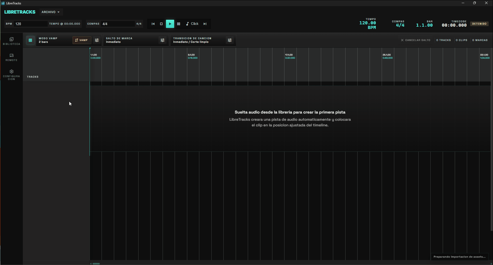

`Crear carpeta virtual` te permite agrupar assets por set, escena, sección o instrumentación sin mover los archivos fuente originales. Un enfoque práctico es usar una carpeta virtual por canción o por bloque del show. Puedes crearla haciendo click en la sección `Sin Carpeta`

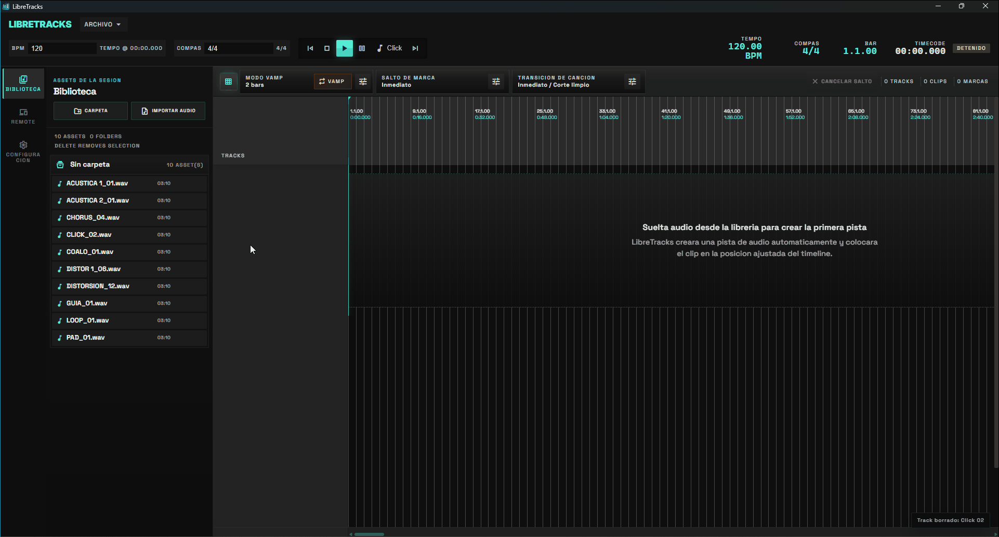

### `Audio track` vs `Folder track`

- `Audio track` es la pista donde viven y suenan los clips.
- `Folder track` sirve para organizar y controlar de forma conjunta las pistas hijas.

Usa `Folder track` cuando quieras agrupar stems, por ejemplo batería, tracks de banda, coros o playback auxiliar. Usa `Audio track` cuando necesites una lane que realmente contenga clips.

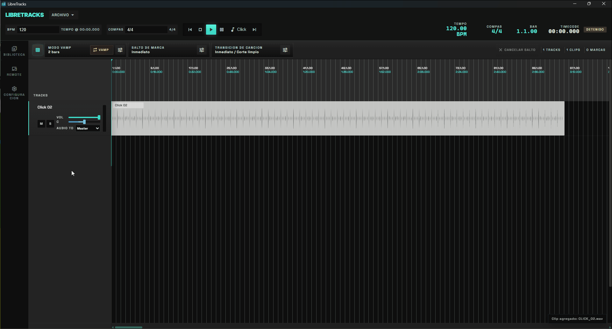

## 4. Edición Básica (Timeline)

LibreTracks mantiene el timeline directo y orientado a directo.

### Añadir y mover clips

- Arrastra assets desde `Biblioteca` al timeline.
- En una sesion vacía, soltar desde `Biblioteca` crea automáticamente la primera `Audio track`.
- Mueve un clip arrastrándolo a una nueva posición del timeline.

### Duplicar clips

- Haz clic derecho sobre el clip.
- Elige `Duplicar`.

Esto va bien para loops, repeticiones y partes de apoyo que vuelven más adelante en la canción.

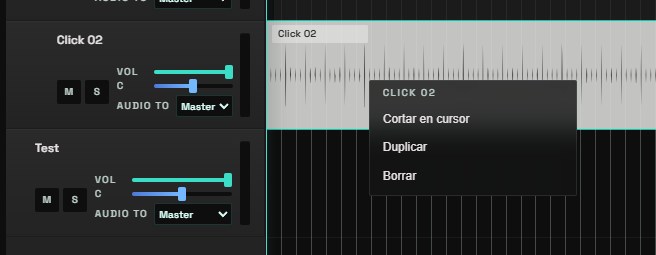

### Cortar clips

1. Lleva el cursor o playhead al punto de corte.
2. Haz clic derecho sobre el clip.
3. Elige `Cortar en cursor`.

Es la forma más rápida de ajustar la estructura sin tocar el WAV original.

### Usa `Snap to Grid`

Mantén `Snap to Grid` activado cuando quieras que clips, cursor y ediciones caigan sobre divisiones musicales. Desactívalo solo cuando necesites colocar algo libremente fuera de la rejilla.

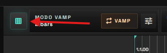

## 5. Control en Vivo: Navegación y Saltos

### `Secciones/Canciones`

Las secciones definen una canción en el timeline

Crea secciones desde el header del timeline:

1. Selecciona la region para crear la canción
2. Click derecho sobre la región 
3. Crear canción desde selección

Una vez creada podrás renombrarla o borrarla

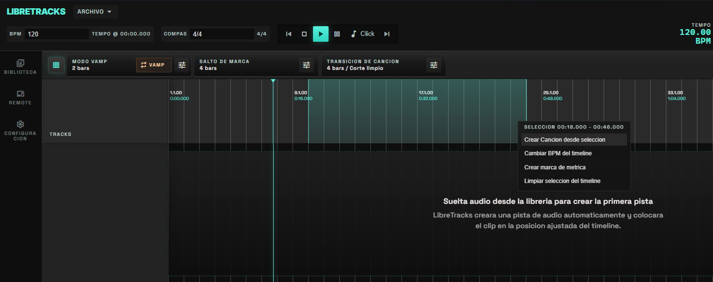

### `Marcas`

Crea secciones desde el ruler:

1. Haz clic derecho sobre el ruler.
2. Elige `Crear Marca`.
3. Renombra la marca si lo necesitas.

LibreTracks puede mostrar marcas con prefijo numérico, por ejemplo `1. Intro`. En la build desktop actual, los atajos `0-9` se resuelven por orden de marca en el timeline: `0` apunta a la primera marca, `1` a la segunda, y así sucesivamente.

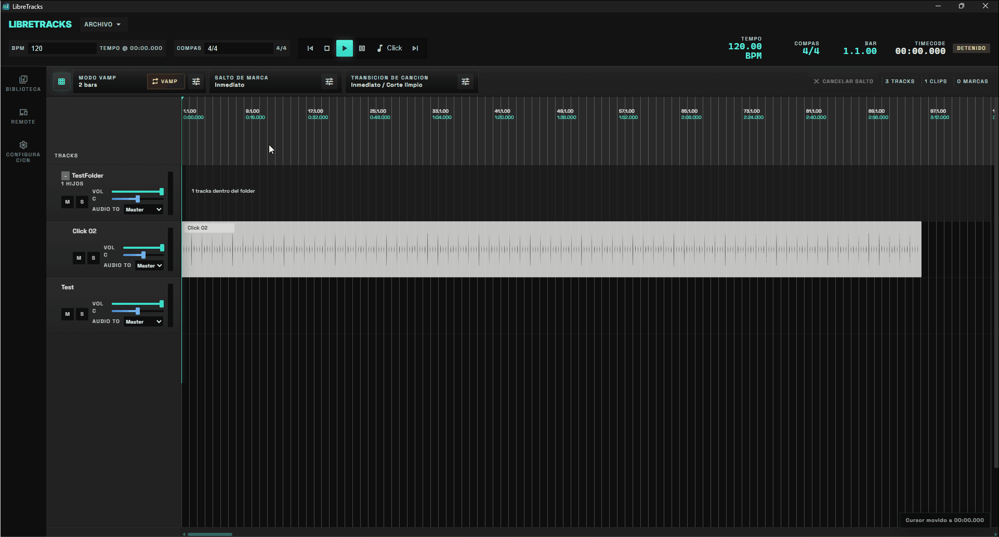

### `Cambio de Tipo de Compas`

Puedes cambiar el tipo de compas en el timeline para ello:

1. Haz clic derecho sobre el header del timeline.
2. Elige `Crear Marca de Metrica`.
3. Selecciona la nueva metrica con formato 4/4 3/6 4/8.

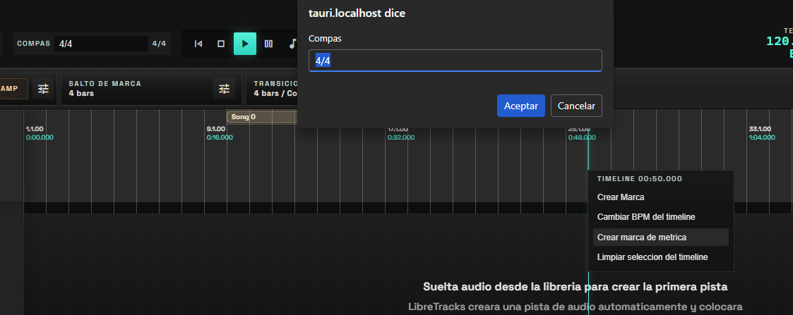

### Tono y tempo

Al cambiar el tono o el tempo de una canción, LibreTracks activa warp automáticamente para mantener el tono y la velocidad independientes. Una canción sin cambios no activa warp; al devolver el tono y el tempo a sus valores originales, warp se desactiva de nuevo. Puedes desactivar `Warp automático` en Ajustes para mostrar el control manual de warp y usar varispeed al cambiar el tono. Cambiar esta preferencia no modifica las canciones existentes.

### Modos de `Salto`

Configura el comportamiento global desde `Salto`:

- `Inmediato`: salta al instante.
- `En la siguiente marca`: espera al siguiente límite de sección y salta allí.
- `Tras X compases`: cuantiza el salto para que ocurra tras el número de compases configurado.

Esto te permite reaccionar en tiempo real si la banda alarga un estribillo, se salta un puente o necesita repetir una sección.

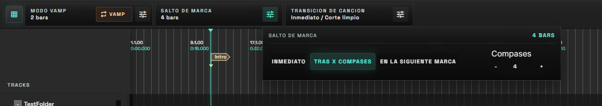

### `Vamp`

Usa `Vamp` para mantener la reproduccion en un bucle musical cuando la banda o la accion de escenario necesita mas tiempo. `Modo Vamp` puede repetir la `Seccion` actual (Las esccines están delimitadas por los marcadores) o un nume-ro fijo de `Compases`. Pulsa `Vamp` de nuevo para salir del bucle.

Salir de Vamp no cambia los ajustes de tono ni de warp. Con warp activado, mantén `T` activado en los instrumentos que deban seguir los cambios de tono de la canción y desactivado en las pistas de clic/guía que deban conservar su tono original. Desactivar `T` no desactiva warp: esas pistas siguen el tempo compartido.

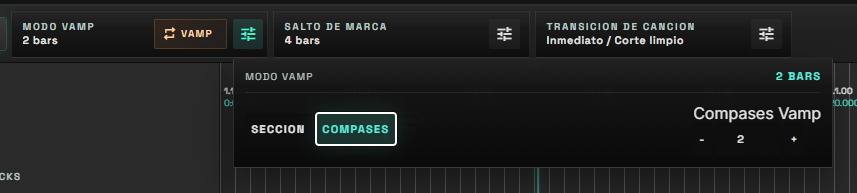

### Saltos de cancion y transiciones

Usa los controles de `Salto de Cancion` cuando la sesion contiene varias regiones de cancion y necesitas moverte a otra zona durante la reproduccion. El disparador puede ser inmediato, tras un numero configurado de compases o al final de la cancion/region.

`Transicion de Cancion` controla como pasa la cancion actual a la siguiente:

- `Clean cut`: cambia directamente.
- `Fade out`: desvanece la reproduccion actual antes del salto.

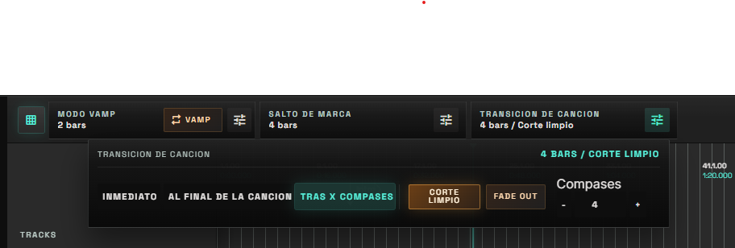

### Arreglos de canción

Un arreglo cambia la forma de una canción sin montar saltos: dos coros más al final, quitar el puente, repetir el verso. El arreglo se escribe en el timeline tal cual (si repites el verso, ves el verso dos veces) y las canciones de después se desplazan solas.

1. **Marca las secciones** de la canción (Intro, Verso, Coro…) en la fila de secciones del ruler, como siempre. Hacen falta al menos dos. Las marcas de aviso (Build, Entra batería…) no cortan secciones: viajan con la sección en la que están.
2. Haz click derecho sobre la canción y elige `Arreglo` (en la vista compacta, en el menú de la canción).
3. Pulsa `Guardar como original`. LibreTracks guarda la canción tal como está para poder montar cualquier arreglo y volver al original cuando quieras. Si alguna marca no cae en el primer tiempo de un compás, te avisa y te ofrece `Ajustar al compás`.
4. **Monta el arreglo**: arriba tienes las secciones de la canción. Haz click en una para añadirla al final, o arrástrala a la tira de abajo para meterla donde la sueltes. En la tira, arrastra los bloques para cambiarlos de orden, `Supr` quita el bloque seleccionado y `Ctrl+D` lo duplica.
5. Pulsa `Aplicar`. El timeline muestra el resultado y las canciones siguientes se colocan detrás, en su compás.

En la vista Setlist, al editar secciones o arreglos, la regla sobre la onda usa la numeración global de compases y muestra pulsos y subdivisiones al acercar el zoom. Puedes arrastrar el playhead por toda la onda, incluso entre secciones. Con `Snap to Grid` activado, se ajusta a la división visible más cercana (compás, pulso o subdivisión); desactívalo para moverlo libremente. El seguimiento automático del playhead solo desplaza la vista mientras Playback está reproduciendo. El arreglo también admite zoom: usa `Ctrl` + rueda o el gesto de zoom del trackpad en escritorio, y los botones `+`/`−` del editor en móvil.

Puedes guardar varios arreglos de la misma canción (`Nuevo`, `Renombrar`, `Eliminar`) y cambiar de uno a otro desde el selector. El primero del selector es siempre `Original`: elígelo y pulsa `Aplicar` para devolver la canción a como era (los arreglos no se borran). El original no se puede borrar ni renombrar; si cambias sus bloques, se crea un arreglo nuevo a partir de él. Si te equivocaste al guardarlo (faltaba una marca, una sección estaba mal puesta), corrige la canción en el timeline y usa `Volver a guardar el original`.

Con un arreglo aplicado, la canción muestra `⇄ Domingo` (el nombre del arreglo) en el ruler, en la vista compacta, en la vista en directo y en el remote, y el ruler sombrea un poco las secciones que son repeticiones.

**Editar una canción con arreglo.** El volumen, el mute, el pan o las salidas de las pistas se cambian como siempre. Para mover, recortar o añadir clips o marcas, LibreTracks te pregunta antes: `Esta canción tiene un arreglo. ¿Editar el original?`. `Editar original` vuelve al original (el arreglo se guarda), editas lo que quieras y, al volver a pulsar `Aplicar`, el arreglo se monta sobre la canción editada. Si quitaste una sección que usaba algún arreglo, te dice de qué arreglos la ha quitado.

**En el móvil y la tablet** el editor ocupa la pantalla: los bloques son una lista vertical. Arrastra por el asa de la derecha para cambiar el orden, desliza a la izquierda para quitar (con `Deshacer` unos segundos), mantén pulsado para `Duplicar` o `Quitar`, y usa el botón `+` para añadir secciones.

Los arreglos viajan en los paquetes de canción (`.ltpkg`) y de sesión (`.ltset`). Si abres la sesión con una versión anterior de LibreTracks, verás el arreglo escrito en el timeline y sonará igual, pero si guardas desde esa versión se pierde el original del arreglo.

### Escenas en directo

Una escena es un estado de mezcla que pones y quitas a mano: por ejemplo, bajar los instrumentos mientras alguien habla al público y devolverlos después. Al quitarla, la mezcla vuelve exactamente a como estaba antes de ponerla.

**Crear una escena.** Abre `Archivo > Escenas de mezcla…` (en el móvil, la hoja `Archivo` del carril lateral; en la vista Setlist, el botón `Escenas` del mezclador). No hace falta ninguna pista de automatismos. El botón `+ Bajar la banda (menos voces)` crea la escena típica: todas las pistas de la canción menos las que se llaman voz, voc, vox, click, guía o guide, −12 dB, con una rampa de 2 segundos.

Cada escena es una lista de **reglas**, que se leen como una frase: a qué pistas, excepto cuáles, y qué cambia.

- **A qué pistas:** `Todas las pistas de la canción` (la que está bajo el cabezal), `Carpeta` (las pistas de dentro de una carpeta con ese nombre), `Nombre contiene` (palabras separadas por comas; no distingue mayúsculas ni tildes, así que «voz» encuentra «Vóz guía» y «VOX» encuentra «BGVox») o una `Pista` concreta.
- **Excepto:** cero o más selectores que se restan.
- **Qué cambia:** volumen (`± dB` sobre lo que tenga cada pista, o `Fijar %`), paneo, mute y solo.

Las reglas por canción, carpeta y nombre valen para **cualquier canción** de la sesión. Debajo de las reglas ves a qué pistas afecta en la canción actual. El número de cada escena (1, 2, 3…) es su orden; cámbialo con las flechas.

**Ponerla y quitarla.** En la vista en directo, en el mezclador del Setlist y en la vista compacta hay un botón por escena: tócalo para ponerla (se ilumina) y otra vez para quitarla. Con el controlador MIDI tienes dos caminos. En `Ajustes > MIDI Learn > Escenas` hay tres filas por escena: `alternar` (un botón pone y quita), `poner` y `quitar` (por si prefieres un botón para bajar y otro para subir); pulsa `Aprender` en la fila y luego el botón del controlador. Funciona desde cualquier vista, también la DAW. Ahí mismo están `Escena 1` a `Escena 8`, que siguen el orden del editor y sirven para cualquier sesión. El otro camino es el modo Mapeo: actívalo, toca el botón de la escena en Live, Setlist o la vista compacta y pulsa el botón del controlador. El LED del controlador sigue a la escena aunque la pongas desde la pantalla o desde un automatismo. Un automatismo también puede `Poner`, `Alternar` o `Quitar` una escena.

**Mientras está puesta:**

- Si mueves a mano el fader, el mute o el solo de una pista (en pantalla o con el controlador), esa pista sale de la escena: al quitarla, se queda donde la dejaste.
- Si la reproducción pasa a la canción siguiente, la escena sigue puesta y se traslada: las pistas de la canción que termina vuelven a su volumen y las de la nueva bajan con la rampa. Las reglas de una pista concreta no se mueven.
- Parar, volver a reproducir o saltar dentro de la canción no la quita.
- Guardar (también al cerrar y al exportar) escribe la mezcla de **antes** de la escena: no volverás a abrir la sesión con la música bajada.

Las escenas viajan con la sesión (`.ltset`) y con las plantillas de sesión. En una plantilla, las reglas por carpeta son especialmente útiles: «Carpeta Instrumentos, −12 dB» funciona en todas las sesiones que crees a partir de ella. Las reglas de una pista concreta no viajan con la plantilla, porque la plantilla no guarda esas pistas.

## Vista Setlist

La Vista Setlist es la vista para tocar en directo si vienes de Playback o de Prime: tus canciones en una fila arriba, la canción elegida con sus secciones sobre la onda en medio y el mezclador abajo. Es la misma sesión que ves en la DAW, mirada de otra manera: lo que cambias aquí se ve en las demás vistas y al revés.

Se abre desde el selector de vistas o con `Tab`, que recorre DAW, Setlist, Compacta y Live (`Mayús+Tab` va al revés). En `Configuración > Atajos` puedes asignar una tecla propia a `Abrir vista Setlist`; viene sin asignar.

### Si vienes de Playback o Prime

| En Playback / Prime | En LibreTracks |
| --- | --- |
| Lista de canciones arriba | Fila de tarjetas de canción. Toca una para verla; con todo parado, además la prepara. |
| Pulsar una canción para que suene | Doble toque o `▶` en la tarjeta. Si ya suena otra, el salto sigue la transición entre canciones (el botón entre dos tarjetas). |
| Mapa de secciones sobre la onda | El mapa de la canción: un bloque por sección, con su ancho real. |
| Tocar una sección para saltar | Parado, un toque. Sonando, doble toque: el salto espera al momento del modo de salto y el bloque parpadea en amarillo; tócalo otra vez para cancelarlo. |
| Live ReOrder con el teclado | `←` `→` mueven un cursor por las secciones y `Enter` salta a la marcada. `↑` `↓` cambian de canción y `Esc` quita el cursor. Los números `1`-`9` siguen saltando directamente. |
| Bucle de una sección | `Vamp`. El tramo que se repite se ve enmarcado sobre la onda con el aviso «En bucle». |
| Mezclador de la canción | El mezclador de abajo, con las pistas de la canción que estás viendo y su master. El botón `Escenas` abre las escenas de mezcla. |
| Editar la canción | `Editar`: ajustes, secciones, arreglo, pistas, carriles, automatismos, MIDI y vídeo. `Hecho` vuelve a tocar. |

### Canciones

- **Elegir**: toca una tarjeta. El mapa, la onda y el mezclador pasan a esa canción. Con el transporte parado, además se prepara para empezar desde su inicio.
- **Reproducir**: doble toque o `▶`. Con una tarjeta enfocada, `Enter` hace lo mismo.
- **Transición**: el botón entre dos tarjetas elige cómo se pasa de una canción a la siguiente (corte o fade) y si se mantiene el vamp entre canciones.
- **Reordenar**: arrastra la tarjeta. La canción se mueve entera, con su audio, sus marcas y su tempo.
- **Menú** (clic derecho o mantener pulsado en el móvil): el mismo menú de la canción que en la DAW, con `Abrir en la DAW` al principio para ir a la canción encuadrada en la línea de tiempo.

### El mapa de la canción

Cada bloque es una sección, con su color y sus compases. El bloque que suena se rellena según avanza y el siguiente queda marcado. Los avisos se ven como etiquetas en la parte baja de la onda y los cambios de nota como una marca lila. El clic derecho en un bloque abre el menú de sección de la DAW, y sobre la onda puedes elegir el arreglo de la canción.

### Controlador MIDI

Activa el modo Mapeo (`Ctrl+M`), toca el control en la pantalla y pulsa el botón del controlador. En la Vista Setlist son mapeables el `▶` de cada tarjeta (salto a la canción N), cada bloque del mapa (salto a la sección N, el mismo que en Live) y los faders del mezclador.

### En el teléfono y la tablet

En el teléfono, como Playback en un iPhone, debajo de las canciones se ven por turnos la onda o el mezclador: cambia con los botones `Onda` y `Mezcla`. En la tablet y el ordenador se ven los tres a la vez; en pantallas medianas el mezclador se puede plegar para dar altura a la onda.

## Exportar canciones y paquetes

Puedes exportar una canción en caso de aberla creado con las regiones, esto exportará toda la configuración de la canción para tenerla disponible en futuras sesiones. Para ello:

1. Crea una canción con la seleccion de región
2. Haz click derecho sobre la región creada
3. Haz click en `Exportar Canción`

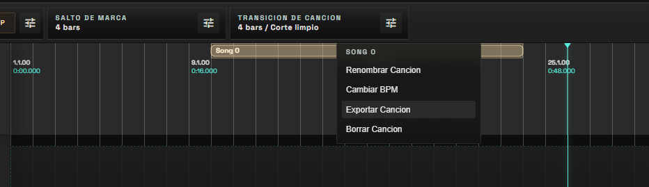

### Renderizar audio de una canción o sesión

Para mandar a cada músico su pista de ensayo (al batería todo menos la batería, al guitarrista todo menos las guitarras):

1. Haz click derecho sobre la canción (en el móvil, mantén pulsada la canción y abre el menú de la barra de selección; en la vista compacta, el menú de la columna).
2. Elige `Renderizar audio…`.
3. Marca las pistas que quieres dentro. Las carpetas tienen su propia casilla para marcar o quitar todas sus pistas de golpe.
4. Elige la salida:
   - `Mezcla (un archivo)`: todas las pistas marcadas en un solo WAV.
   - `Pistas por separado (.zip)`: un WAV por pista, todos alineados desde el inicio de la canción, dentro de un `.zip`.
5. Ajusta formato (WAV 16/24/32 bits), frecuencia de muestreo, estéreo o mono, y si quieres:
   - `Aplicar la mezcla`: volumen y paneo de cada pista y carpeta y el volumen de la canción, como suenan al reproducir. Desmarcado, todas salen a 0 dB y centradas.
   - `Normalizar`: deja el pico de cada archivo en -0,3 dB.
   - `Incluir el metrónomo` / `Incluir la voz guía`: con tu configuración actual. En pistas por separado salen como archivos propios.
6. Pulsa `Renderizar` y elige dónde guardarlo.

El render respeta el cambio de tono y el warp de la canción, y no depende de mute ni solo: sale lo que marques. Puedes seguir reproduciendo mientras se renderiza.

Para renderizar la sesión, abre `Archivo` > `Renderizar audio de la sesión…` (en móvil, el menú de archivos). Elige toda la línea de tiempo en un archivo o cada canción por separado en un ZIP. También puedes cambiar el intervalo desde el diálogo de una canción. La opción de pistas separadas funciona en ambos casos; al elegir canciones separadas, el ZIP contiene las pistas de cada canción.

Las pistas se agrupan por canción; las compartidas y las que están fuera de canciones aparecen en grupos propios. `Quitar click / guía` desmarca de una vez las pistas identificadas por su nombre o el de su carpeta; vuelve a pulsar `Incluir click / guía` para recuperarlas. Las casillas del metrónomo y la voz guía de la aplicación son independientes de estas pistas.

En estéreo puedes ajustar por separado el paneo del conjunto de pistas, del metrónomo y de la voz guía. El paneo de las pistas se aplica después del paneo del mezclador, sin modificarlo. En mono estos controles no se aplican.

Cada intervalo renderizado está limitado a tres horas. Para sesiones más largas, usa la salida por canción siempre que cada canción esté dentro de ese límite.

### Importar canciones y paquetes

Usa `Importar cancion` desde la sección `Archivo` en la parte superior cuando quieras traer otra cancion o paquete de sesion de LibreTracks a la sesion actual. Es util para construir un show a partir de canciones preparadas sin rehacer pistas y marcas a mano.

### Atajos

- `Espacio`: alterna `Reproducir` / `Pausar`
- `Esc`: cancela un salto pendiente
- `0-9`: arma un salto hacia la marca correspondiente
- `Shift + 0-9`: arma un salto hacia la canción seleccionada. El 0 se corresponde con la primera cación, 1 la segunda, 2 la tercera...

Si armas la sección equivocada, pulsa `Esc` inmediatamente. Si no existe una marca para ese hueco, LibreTracks avisará de que no hay una marca disponible para ese dígito.

## Vídeo

LibreTracks puede proyectar vídeos (letras, fondos, clips) sincronizados con el audio en una segunda pantalla: un proyector o una TV. El audio manda: el vídeo sigue al transporte, a los saltos, a los vamps y al warp, nunca al revés.

> En Windows y en macOS (12 o posterior) funciona tal cual: la app trae lo necesario. En Linux hace falta tener instalado `libmpv` (paquete `libmpv2` o `mpv-libs` según la distribución). En iPhone, iPad y Android también: ver [Vídeo en iPhone, iPad y Android](#vídeo-en-iphone-ipad-y-android).

### Añadir vídeo

1. Arrastra un vídeo (`.mp4`, `.mov`, `.mkv`, `.webm`…) desde el explorador al timeline o a la biblioteca. Si lo sueltas sobre una pista de audio, se crea una pista de vídeo al lado.
2. El clip de vídeo se mueve, recorta, divide, duplica y borra como uno de audio, y tiene fundidos de entrada y salida y su propio encaje (clic derecho).
   En la Vista Setlist, abre `Editar → Vídeo` para ajustar los clips sobre la onda de la canción: arrastra el cuerpo para moverlo, los bordes para recortarlo y los tiradores superiores para cambiar los fundidos. El botón de duplicar está junto a cada clip; el menú conserva las demás acciones.
3. Si el vídeo trae sonido, LibreTracks pregunta si quieres **extraerlo como pista de audio**: queda en una pista nueva justo debajo, alineada con el vídeo. Puedes marcar "Recordar mi elección", y hacerlo más tarde con clic derecho → `Extraer audio`.

### Configurar la pantalla

La primera vez que añades un vídeo se abre el **asistente**: eliges la pantalla (cada una muestra su número para que la reconozcas), compruebas que la carta de ajuste se ve en el proyector, eliges encaje y pantalla de reposo y, si quieres, calibras. Nada se guarda hasta pulsar `Listo`.

Todo se puede cambiar después en `Ajustes → Vídeo`: pantalla, pantalla completa o ventana, encaje (ajustar, rellenar, estirar), pantalla de reposo (negro o una imagen), qué mostrar al parar y decodificación por hardware. Si solo tienes un monitor, puedes usar el modo ventana mientras tanto.

Haz **doble clic en el vídeo** para pasar de pantalla completa a una ventana que puedes mover y redimensionar, y otro doble clic para volver. En pantalla completa el vídeo queda por delante de todo, incluidas las notificaciones; si prefieres que otras ventanas puedan ponerse delante, desactiva `Pantalla completa siempre delante` en `Ajustes → Vídeo`.

La ventana de vídeo solo se abre cuando la sesión tiene algún vídeo. Mientras la tenga, en la barra de arriba aparece un icono de cámara: haz clic en él para ocultar o volver a mostrar la ventana. Cerrar la ventana de vídeo equivale a apagar la salida, y el mismo icono la vuelve a encender.

El indicador de la barra superior dice en qué pantalla sale el vídeo y avisa si se desconecta. Al volver a conectarla, la imagen vuelve sola.

### Calibrar el retardo

Proyectores y TVs muestran la imagen con algo de retraso. En `Ajustes → Vídeo → Calibrar…`, con el metrónomo activo y en reproducción, la salida destella en cada pulso: mueve la compensación hasta que destello y clic coincidan. También puedes tocar 10 veces al ver el destello y 10 al oír el clic, y aplicar la compensación que te sugiere.

### Control en directo

| Acción | Atajo | También por |
| --- | --- | --- |
| Vídeo: negro (y vuelta) | `B` | MIDI learn, botón `Negro` del remote |
| Vídeo: fundido a negro | sin asignar | MIDI learn |
| Vídeo: mostrar reposo | sin asignar | MIDI learn |
| Vídeo: activar/desactivar salida | sin asignar | MIDI learn |

El negro no para nada: el vídeo sigue sincronizado por debajo y, al quitarlo, vuelve ya en su sitio. Mientras está activo el indicador muestra **VÍDEO EN NEGRO**. No se guarda: al reiniciar la app la salida arranca normal. Los atajos se cambian en `Ajustes → Atajos`.

### Formatos recomendados

- **H.264 en `.mp4`** con un fotograma clave por segundo (GOP de 1 s). Los saltos y vamps son inmediatos.
- Con fotogramas clave muy separados (más de 2 s), LibreTracks lo marca en la biblioteca: los saltos a mitad de un vídeo así pueden tardar un instante. Para reexportarlo con ffmpeg: `ffmpeg -i entrada.mp4 -c:v libx264 -g 30 -keyint_min 30 -c:a copy salida.mp4` (para 30 fps).
- HEVC, ProRes y VP9 funcionan; 4K necesita un equipo con decodificación por hardware.

### Paquetes con vídeo

Al exportar una canción (`.ltpkg`) o la sesión (`.ltset`) con vídeos, el diálogo avisa de cuántos hay y cuánto ocupan, con la casilla `Incluir los vídeos en el paquete`:

- Marcada: los vídeos viajan dentro del paquete (incluidos los de la biblioteca que no estén en el timeline) y se abren en otro equipo sin buscar nada.
- Desmarcada, o en modo Ligero: los vídeos no viajan; en otro equipo aparecen como archivos que faltan y se reubican.
- Si subes la sesión a la nube y los vídeos pasan de 500 MB, la casilla empieza desmarcada.

Al importar en Android o iOS un paquete con vídeos, LibreTracks pregunta antes si traerlos, diciendo cuánto ocupan y cuánto espacio libre queda (ver la sección siguiente).

### Vídeo en iPhone, iPad y Android

El móvil o la tablet manda el audio **y** el vídeo: el proyector muestra solo el vídeo a pantalla completa y en el móvil sigues con LibreTracks, igual que con la ventana de vídeo del ordenador.

**Cómo conectar el proyector**

| Dispositivo | Qué necesitas |
| --- | --- |
| iPhone 15 o posterior, iPad con USB-C | Cable USB-C a HDMI |
| iPhone con Lightning (hasta el 14) | Adaptador Lightning Digital AV de Apple + cable HDMI |
| iPhone o iPad sin cable | AirPlay hacia un Apple TV o una TV compatible, con `Duplicar pantalla` (experimental: ver abajo) |
| Android | Un móvil con salida de vídeo por USB-C (DisplayPort) y un cable USB-C a HDMI |

- **Android: no todos los móviles sacan imagen.** Suelen tenerla los Samsung de gama media-alta, los Pixel 8 o posteriores, la mayoría de tablets recientes y algunos Motorola y Xiaomi. Si al conectar el cable no aparece ninguna pantalla, tu móvil no tiene esa salida y ninguna app puede dársela.
- **Samsung:** al enchufar puede abrirse DeX. Desactívalo (o elige "Duplicar") para que LibreTracks vea la pantalla.
- **AirPlay es experimental:** el retardo depende del Wi-Fi y puede variar durante la actuación. Calibra en el sitio (`Ajustes → Vídeo → Calibrar…`) y, para un directo, mejor el cable.

**Lo primero que se hace solo:** al poner el primer vídeo en el timeline se abre un asistente de dos pasos: conecta el proyector (si en 20 segundos no aparece nada, te dice qué revisar) y comprueba que ves la carta de ajuste. Por defecto el vídeo sale por **la primera pantalla externa** que aparezca; en `Ajustes → Vídeo` puedes fijar una concreta si tienes cable y AirPlay a la vez.

**Sin vídeo, la pantalla de reposo.** Con la salida activada y un proyector conectado, LibreTracks lo ocupa aunque la sesión no tenga vídeo y muestra la pantalla de reposo (negro o la imagen que elijas en `Ajustes → Vídeo`): sin eso, el móvil duplicaría su propia pantalla y el público vería la app. Para usar el proyector para otra cosa, desactiva la salida de vídeo.

**El bloqueo del móvil apaga el proyector.** Mientras la salida de vídeo está activa, LibreTracks evita que el móvil se bloquee solo. Si lo bloqueas tú con el botón (o cambias de app), el sistema deja de mandar imagen: el audio sigue sonando, el indicador de arriba muestra **Proyector apagado** y, al desbloquear, la imagen vuelve ya sincronizada.

**Indicador y negro:** en la barra superior hay dos iconos: el estado de la salida (tócalo para ver la pantalla, los reproductores y los avisos) y el **negro a un toque**, que solo se activa con la salida mostrando algo.

**Tener los vídeos en el móvil**

- **Paquetes `.ltset` / `.ltpkg` y la nube:** si traen vídeos, LibreTracks pregunta "Importar también los vídeos", con lo que ocupan y el espacio libre. Viene marcado si caben dejando 1 GB libre; si no caben, no se puede marcar. Sin ellos la sesión suena igual, los clips se conservan y no aparecen como archivos que faltan. Al bajar una sesión grande de la nube con datos móviles, primero pregunta: mejor con Wi-Fi.
- **Desde el propio dispositivo:** `Añadir vídeo del dispositivo` en el menú de una pista de vídeo, en el `+` de pistas o en la biblioteca. El vídeo **se copia** a la carpeta de la sesión (para que viaje con ella), después de decirte cuánto ocupa.
- Un vídeo que el móvil no sabe decodificar (por ejemplo ProRes en Android, o HEVC de 10 bits en un móvil sencillo) aparece como **No reproducible en este dispositivo**: no se borra y sigue sonando su audio si lo extrajiste en el ordenador.

**Editar en el timeline y en la Vista Setlist:** igual que los clips de audio en el móvil: toca un clip para seleccionarlo y arrástralo (o sus bordes, o las asas de fundido) ya seleccionado. En `Editar → Vídeo`, duplicar está junto al clip y el menú muestra el resto de acciones. Extraer el audio de un vídeo solo se puede hacer en el ordenador.

**Gama baja:** algunos móviles solo tienen un decodificador de vídeo. Entonces el indicador dice "Un solo reproductor": los saltos de sección pueden congelar la imagen un instante, pero el audio no se ve afectado.

## 6. Control Remote Movil

LibreTracks desktop puede publicar una superficie web remota para controlar transporte y mixer.

### Conectar movil o tablet

1. Abre `Remote` desde la navegacion lateral en la app desktop.
2. En `Conectar remote movil`, escanea el codigo QR o abre una de las URLs mostradas:
	- `URL por IP`
	- `URL por hostname (.local)`
3. Verifica que desktop y movil esten en la misma red local.

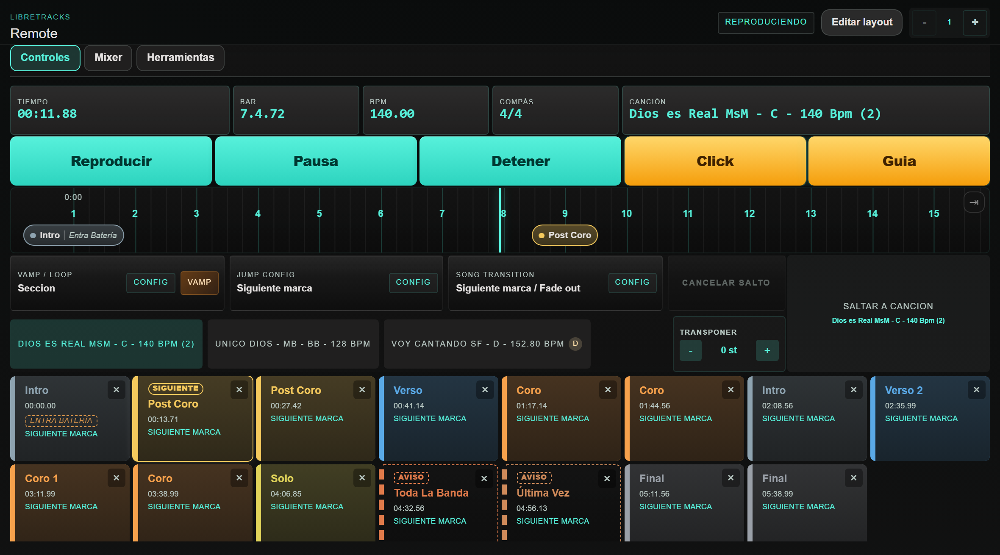

### Uso remoto en ensayo/show

- Usa controles de transporte (`Reproducir`, `Pausar`, `Detener`) desde el movil.
- Arma y cancela saltos desde remote cuando necesites adaptar secciones en vivo.
- Activa `Vamp`, ajusta saltos de marca/cancion y selecciona el modo de transicion de cancion desde el remote.
- Cambia a `Mixer` para ajustar volumen, paneo, mute y solo por pista sin tocar el desktop.

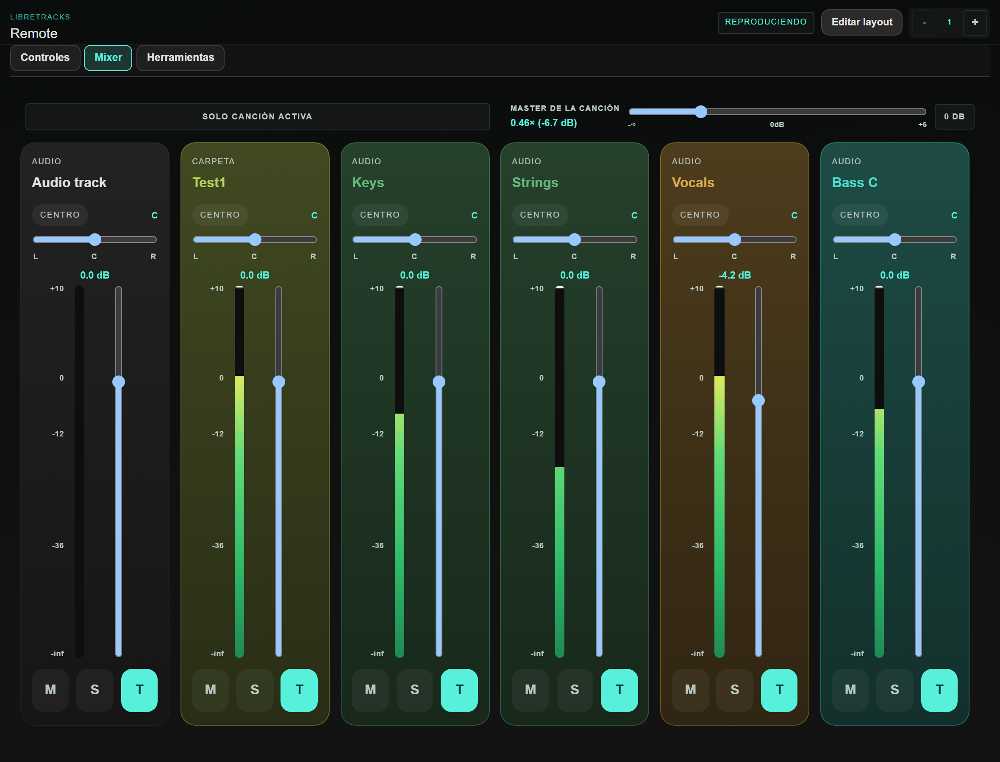

> Sugerencia de flujo en directo: deja al operador desktop centrado en timeline/arreglo y asigna a una segunda persona los ajustes de mezcla/cues desde el remote.

### Sesiones de red entre dispositivos LibreTracks

`Sesion de red` conecta otra instalacion de LibreTracks al anfitrion; es
distinta del control web `Remote`. El invitado puede elegir DAW, Setlist,
Compacta o Live sin cambiar la vista del anfitrion.

| Rol | Acciones sobre el anfitrion |
| --- | --- |
| Espectador | Consultar canciones, secciones, letras, mezcla y estado de video. Seleccionar una cancion para verla no dispara un salto. |
| Controlador | Lo anterior, mas transporte, saltos (incluidos proxima seccion y proximo cue), vamp, orden de canciones, transiciones, pausa al final, vamp entre canciones, duracion del fade-stop y control de salida de video. |
| Editor | Lo anterior, mas mezcla, metronomo, guia de voz, pads ya instalados, modo de medicion de niveles y edicion de canciones, secciones, arreglos, clips, MIDI y automatizacion. Incluye borrar, deshacer y rehacer. |

Los controles no permitidos se desactivan y se actualizan si el anfitrion cambia
el rol o se pierde la conexion. El anfitrion tambien valida cada comando.
Negro, fundido a negro y activar/desactivar la salida de video actuan sobre
el anfitrion, cuyo estado se refleja en los invitados.

El idioma y las preferencias de navegacion/seguimiento del cursor se guardan
solo en el dispositivo invitado. Los ajustes de reproduccion autorizados se
guardan en el anfitrion y se aplican a su motor. Cambiar el sonido del click,
la guia o los pads no sobrescribe otros ajustes ni las rutas de audio.

Importar, exportar, analizar/renderizar, guardar el proyecto, gestionar archivos
o instalar pads requiere hacerlo en el anfitrion. Sus dispositivos de audio,
puertos MIDI, carpetas, rutas auxiliares y configuracion de pantallas tampoco
se reconfiguran desde el invitado.

## 7. Solucion de problemas

### Linux: pantalla blanca al abrir

En algunas configuraciones de Linux (drivers NVIDIA, distros inmutables como Bazzite, Fedora Silverblue o SteamOS, y ciertos compositores Wayland) la ventana puede abrirse en blanco sin pintar la interfaz. Es un problema conocido del motor web WebKitGTK que usa la app, no un fallo de LibreTracks.

LibreTracks ya aplica automaticamente la mitigacion recomendada al arrancar, asi que en la mayoria de los casos no tienes que hacer nada: simplemente actualiza a la ultima version.

- Si prefieres mantener la aceleracion grafica acelerada (porque tu equipo pinta bien sin la mitigacion), define la variable de entorno `LIBRETRACKS_KEEP_DMABUF=1` antes de abrir la app.
- En distros inmutables, instala el **AppImage** o usa un contenedor `distrobox` en lugar de instalar el `.rpm` sobre el sistema base.
